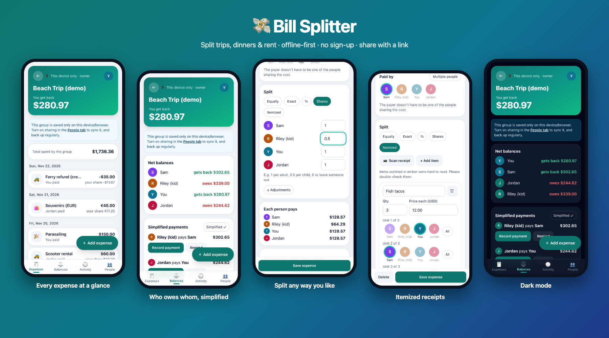
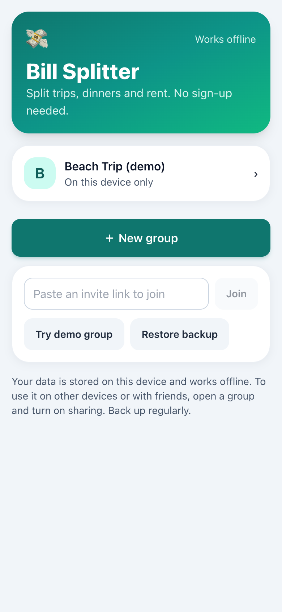
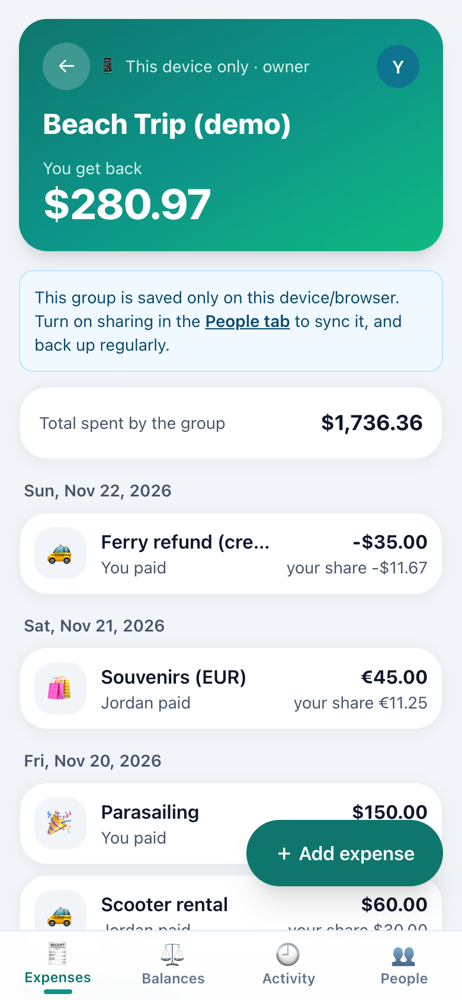
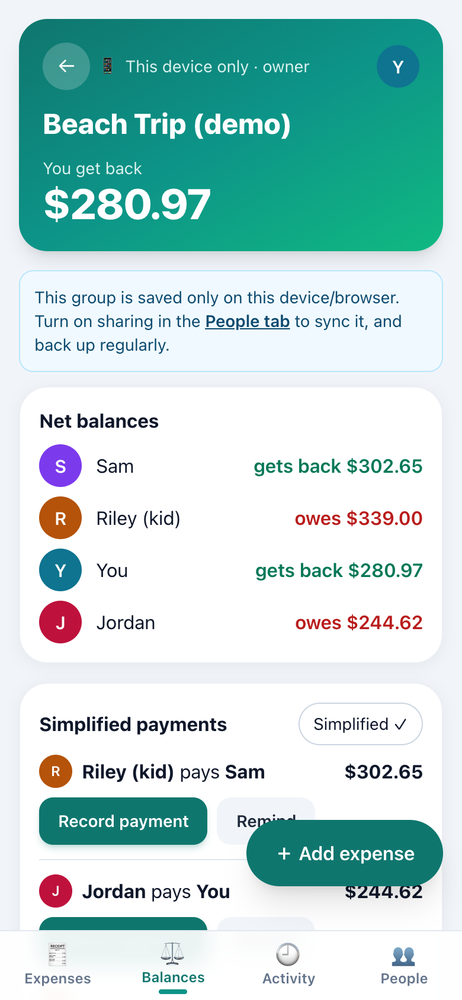
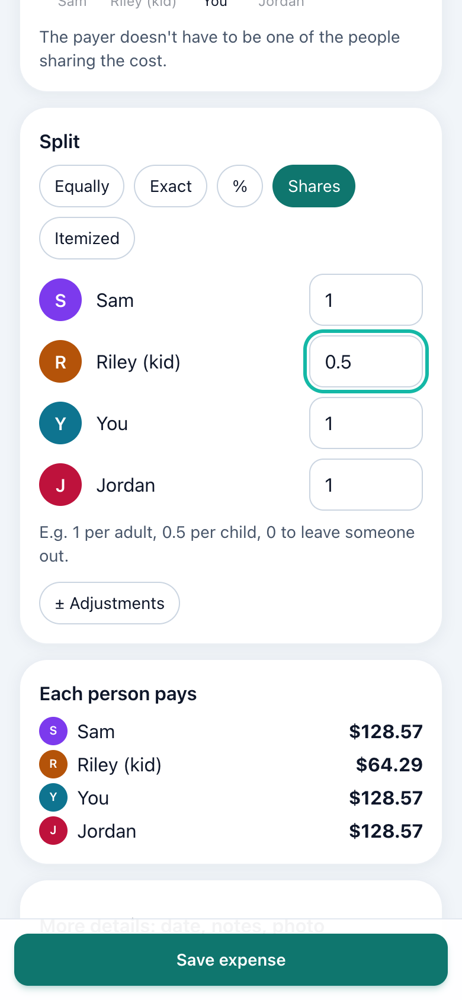
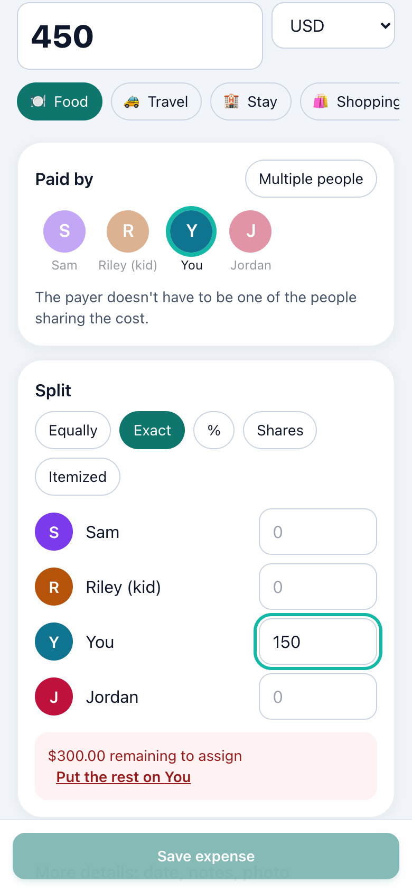
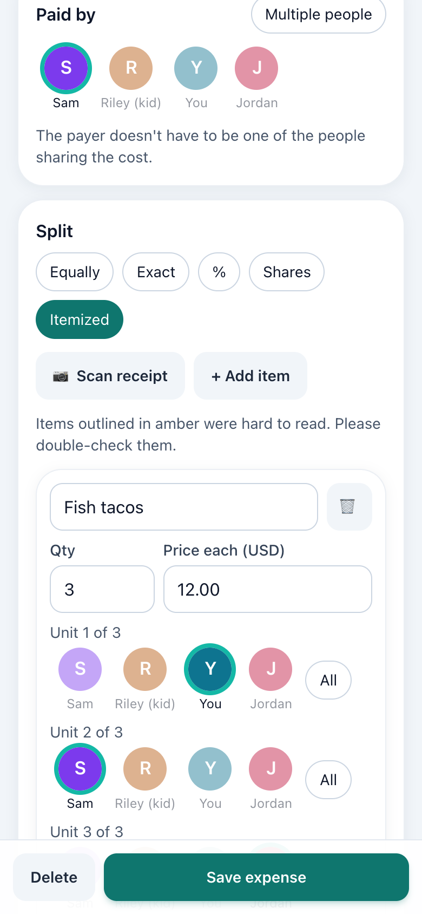
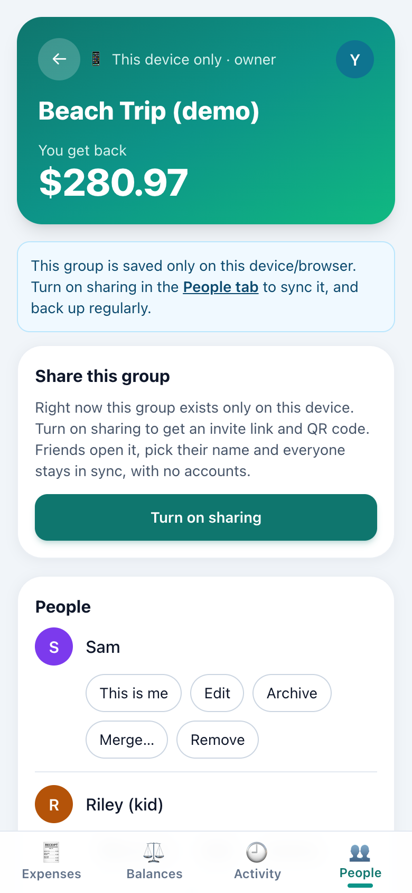
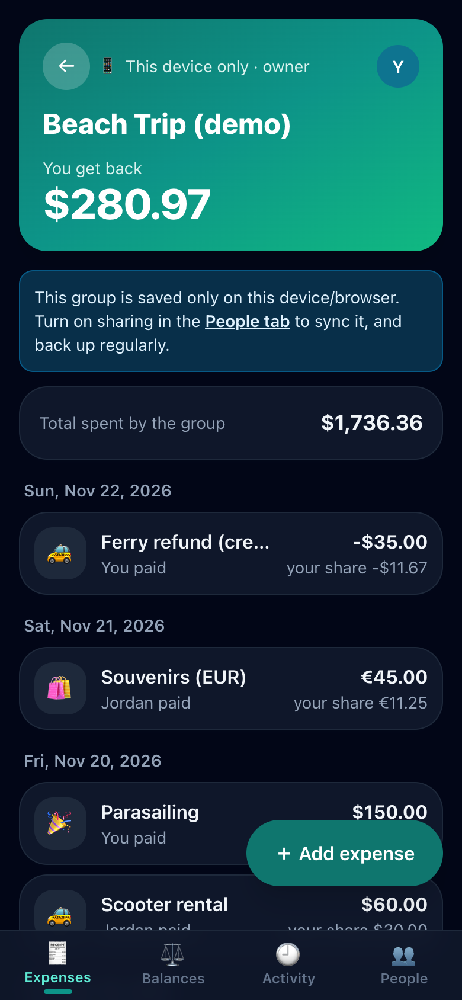
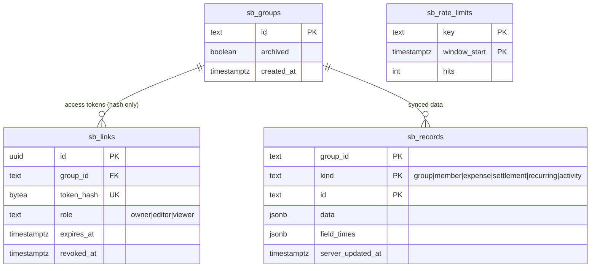

# Bill Splitter

Mobile-first, offline-first PWA for splitting group expenses. React + TypeScript + Vite + Tailwind, Dexie (IndexedDB) on the device, optional Supabase sync with **no accounts** (token links). Everything used is free/open source.

<p align="center"></p>

<table>
  <tr>
    <td align="center"><br><sub><b>Your groups</b></sub></td>
    <td align="center"><br><sub><b>Expenses by day</b></sub></td>
    <td align="center"><br><sub><b>Simplified payments</b></sub></td>
    <td align="center"><br><sub><b>Live "each person pays"</b></sub></td>
  </tr>
  <tr>
    <td align="center"><br><sub><b>Live errors + one-tap fix</b></sub></td>
    <td align="center"><br><sub><b>Itemized receipts</b></sub></td>
    <td align="center"><br><sub><b>Sharing, QR &amp; members</b></sub></td>
    <td align="center"><br><sub><b>Dark mode</b></sub></td>
  </tr>
</table>

> Screenshots are of the built-in demo group (**Try demo group** on the home screen).

## Quick start

```bash
npm install
npm run dev          # http://localhost:5173  (works fully offline-first without Supabase)
npm test             # 118 tests (unit, property-based, SQL/RLS, two-device sync)
npm run build        # type-check + production build + service worker
```

### Test on your phone via ngrok

```bash
npm run share        # dev server + ngrok tunnel (hot reload)
npm run share:prod   # production build + tunnel (tests the real PWA/offline behaviour)
```
Open the `https://….ngrok-free.app` URL that ngrok prints (also at http://127.0.0.1:4040) on your phone. HTTPS means "Add to Home Screen", camera capture and the service worker all work. Invite links are built from the page's origin, so links you create on the tunnel URL open correctly on other phones while the tunnel is running. Requires `ngrok config add-authtoken <token>` once. Free ngrok shows a one-time "Visit site" interstitial.

Tap **Try demo group** on the home screen for seeded data covering every split mode.

## Enable sharing/sync (Supabase, free tier)

1. Create a project at supabase.com.
2. SQL Editor → run [`supabase/migrations/0001_init.sql`](supabase/migrations/0001_init.sql).
3. Project Settings → API: copy the **Project URL** and **anon public key**.
4. `cp .env.example .env` and fill `VITE_SUPABASE_URL`, `VITE_SUPABASE_ANON_KEY`.
5. Do **not** enable anonymous sign-ins or add any table policies: the design needs none (see below).

Without these variables the app hides sync and stays 100% local.

## Deploy to Vercel

1. Push this folder to a Git repo, then "Add New Project" in Vercel and import it (Framework preset: Vite).
2. Add the two env vars above (Settings → Environment Variables).
3. Deploy. [`vercel.json`](vercel.json) provides the SPA rewrite (so `/join/<token>` links work), a no-cache `sw.js`, and a CSP that allows Supabase, the exchange-rate API and Tesseract's language file CDN.
4. Open the site on a phone → Android: "Install"; iOS Safari: Share → Add to Home Screen (the app shows these hints).

## Architecture

```
src/core/      PURE logic, no IO: money, split, rounding, balances, simplify, recurring, UPI, sanitising
src/db/        Dexie schema + repo.ts (the ONLY write path: record + audit entry + outbox in one transaction)
src/sync/      merge.ts (per-field LWW, stamps, tokens) · engine.ts (pull→push, invites) · remote.ts (RPC wrapper)
src/lib/       ocr (Tesseract + receipt parser), image (compress/EXIF strip), backup, share/export, rates, pwa, demo
src/pages/     Home, Join, Group (+ Expenses/Balances/Activity/People), ExpenseForm
supabase/      migrations/0001_init.sql
tests/         core, balances, merge, lib, rls (real SQL in PGlite), sync (2 devices through the real SQL)
```

**Local-first:** every change is written to IndexedDB first. If the group is shared, the record is also queued in an `outbox` (one row per record, coalesced). The engine pulls (so conflicts are detected against unsent edits), then pushes in batches of 50. Retries are harmless because ids are client UUIDs and the server merge is idempotent. Sync runs on launch, on `online`, on tab focus, ~400 ms after a local write, and every 8 s while visible.

### Dexie schema (v1)
`groups(id,updatedAt) · members(id,groupId) · expenses(id,groupId,date) · settlements(id,groupId) · recurring(id,groupId) · activity(id,groupId,at) · photos(id,groupId) · outbox(key,groupId) · local(groupId) · conflicts(++id,groupId) · rates(key) · meta(key)`.
Every synced record carries `id, updatedAt, deleted, fieldTimes{field→stamp}`.

### Supabase schema & ER diagram



### Access control ("RLS") design, and a deliberate deviation
You asked for RLS policies keyed on the token. Supabase **Realtime can't be secured by a custom token header** (it authenticates with a JWT), and you asked for no login, so I chose:

* All four tables have **RLS enabled with deny-all policies and all privileges revoked** from `anon`/`authenticated`. The API key can't read or write any table.
* The only entry points are `SECURITY DEFINER` RPCs (`sb_create_group, sb_redeem, sb_pull, sb_push, sb_create_link, sb_revoke_link, sb_list_links, sb_delete_group`). Each hashes the presented 128-bit token (SHA-256; only hashes are stored), checks revoked/expired **on every call** (so revocation works mid-session), enforces role (viewer can't push; only owner manages links/group settings), refuses writes into other groups, caps batch (100) and record (64 KB) size, and rate-limits per IP/link.
* Consequently **sync is polling (8 s), not Realtime.** Verified by `tests/rls.test.ts`, which runs the real migration in Postgres (PGlite) and attacks it as `anon`.

### Conflict rule
Per-field last-write-wins. Stamps are `"<ISO time>~<device id>"`, so they're totally ordered and identical in JS and SQL (`COLLATE "C"`). Edits to different fields from two devices both survive; same-field edits keep the later one. If *both* sides edited the same field from the same base, a visible **conflict notice** banner appears and the log can undo it. `deleted` is just another field, so delete/restore merge like edits.

## Algorithms (src/core)

* **Money:** integer minor units everywhere. `parseAmount` is string-based and *rejects* too many decimals instead of rounding (JPY 0, KWD 3). Conversions use BigInt with a rate frozen on each expense/settlement; base-currency conversion of allocations (`convertAllocation`) rounds each part then redistributes ±1 so balances still sum to exactly 0.
* **Rounding, largest remainder:** `floor(total·wᵢ / W)` for each person (BigInt, exact), then the leftover units go one each to the largest fractional remainders, ties by index. Sum always equals the total; negative totals (refunds) mirror. 100 ÷ 3 → 34/33/33.
* **Split modes:** equal, exact (live "remaining" + "put the rest on X"), percent (basis points; "scale to 100%"), shares (decimals like 0.5), ± adjustments (carved out of the total, rest split by the mode), itemized.
* **Itemized:** each *unit* of an item has its own sharers (3×₹50 can go to three people); a unit's price splits among sharers by largest remainder. Discount (capped to the subtotal) applies before or after tax (toggle); tax/service/tip are % or flat; each extra is distributed proportionally to subtotals or equally (toggle), again by largest remainder, so shares sum to the bill exactly. Unassigned units block saving.
* **Balances:** `paid − owed` per person in base currency; payments move balance from payer to payee (overpayment = credit automatically).
* **Simplify debts:** greedy; repeatedly match the largest debtor with the largest creditor for `min(debt, credit)`. Each step zeroes someone ⇒ at most n−1 transfers; circular debts net to zero and vanish. (Minimising transfers exactly is NP-hard; greedy is optimal-ish, not provably minimal.)

## Edge cases → tests

| Area | Where tested |
|---|---|
| minor units, ≤2 decimals / JPY / KWD, zero, negative, huge | `money.test.ts`, `split.test.ts` |
| remainder distribution; Σshares = total; Σbalances = 0 | property tests in `split.test.ts`, `balances.test.ts` (fast-check) |
| percent ≠ 100, exact ≠ total, remaining + auto-fix | `split.test.ts` |
| multi-currency frozen rates, settle in another currency | `balances.test.ts` |
| remove with balance, archive, duplicate names, rename, merge | `balances.test.ts`, UI in People tab |
| payer not participant, only-participant, late participant | `balances.test.ts`, `split.test.ts` |
| qty items, shared/subset, unassigned, tax/tip/discount toggles, OCR parsing | `split.test.ts`, `lib.test.ts` |
| partial/overpay, circular debts, edit delta, delete-after-settlement | `balances.test.ts` |
| offline queue, concurrent edits, idempotent retries, soft delete/undo | `sync.test.ts` (2 devices vs real SQL), `merge.test.ts` |
| tampered/expired/revoked token (incl. mid-session), archived group, roles, limits | `rls.test.ts`, `sync.test.ts`, `merge.test.ts` |
| storage cleared/evicted → restore, backup reminder, corrupt backup | `sync.test.ts` |
| XSS-safe names/notes (React escaping + sanitiser), CSV injection, UPI param injection | `misc.test.ts`, `lib.test.ts` |
| recurring dates, month-end clamping, deterministic ids; backdating | `misc.test.ts` |

## Known limitations (please read)

* **Not verified on a live Supabase project or a deployed Vercel site.** SQL is tested in PGlite (Postgres-in-WASM); the browser was smoke-tested in desktop Chrome (mobile viewport, offline reload). **Not tested on a real iPhone**, nor tested: Web Share, camera capture, real OCR on real receipts, PDF output, `navigator.storage.persist()` outcomes.
* **No Realtime:** polling every 8 s (see access-control section). Photos are **device-local only**, not synced.
* **Evicted-storage detection** relies on a `localStorage`/IndexedDB marker; if iOS wipes *all* site data the app looks like a fresh install, so the first-run screen offers "Restore backup" and "paste invite link".
* Whoever holds a link has its access level; there are no per-person identities, so "who did it" in the log is the device's chosen name and can be wrong. Owner links are powerful, so share sparingly. Anyone who loses all owner devices can't manage links.
* OCR (Tesseract.js) is rough on crumpled/low-light receipts and downloads its English language file on first use (needs internet once); everything it finds is editable by design.
* Free exchange-rate API (frankfurter.app, ECB) doesn't cover every currency (e.g. KWD/AED); enter the rate manually. PDF uses the built-in font, so ₹ prints as "Rs".
* Greedy debt simplification is not guaranteed to be the global minimum number of transfers. UPI payment links/QR are an optional India-only extra (shown only for INR groups); other currencies use the share text and reminder messages. The default currency follows the browser locale (USD if unknown).
* Rate limiting is per IP/link inside Postgres, which is sufficient for casual abuse, not a determined attacker. There's no per-group quota on stored records.
* Recurring expenses are generated when someone opens the app/group (no server scheduler); they split equally among active members.
* Schema migrations: Dexie is at v1; future changes will need a new `version()`.
